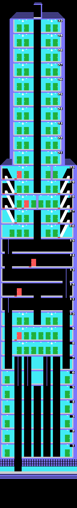
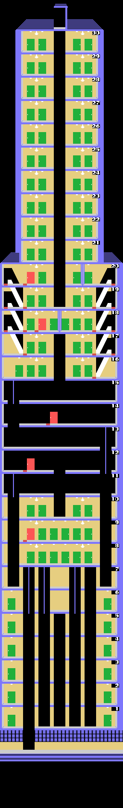
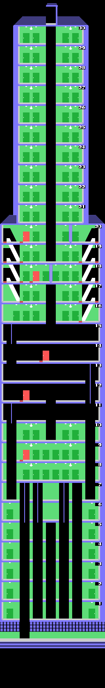
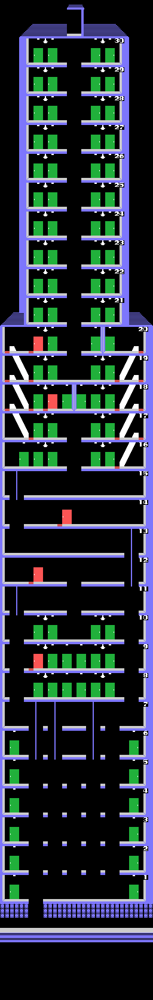

# The building

The building is always the same: thirty floors, the roof with its aerial and the basement with the car. What changes
from one round to the next are the colours, which doors are red and which lift reaches the basement.

These pictures are not screenshots. `tools/mapas.py` runs the ROM itself on a Z80 written in Python: the graphics
loader (`monta_edificio`, 0x4691), the drawing of the map in RAM (`dibuja_edificio`, 0x7E91), the lifts
(`ascensores_nuevos`, 0x605A) and the doors (`puertas_nuevas`, 0x6765). Then it paints the whole map with the
patterns left in VRAM. It has been checked against openMSX's RAM at the same point of round 1
(`tools/guiones/mapa.tcl`, stopped at 0x42A5): **of 7,168 tiles, 7,052 are the same**, and the 116 that differ are
exactly what is drawn by lot (red doors, the basement lift, the lift positions) and the cable of round 1.

## The three colour sets

Rounds 1, 4, 7... use the colours at 0x8D18; 2, 5, 8... those at 0x8D38; 3, 6, 9... those at 0x8D58
(`colores_ronda`, 0x4798). In the dark, after a lamp breaks, those at 0x8D78 are loaded.

| rounds 1, 4, 7... | rounds 2, 5, 8... | rounds 3, 6, 9... | in the dark |
|---|---|---|---|
|  |  |  |  |

## How it is drawn

The map lives in RAM, from 0xC400 to 0xDFFF: 32 tiles wide and 224 rows. The screen shows 21 rows and the scroll
moves one row at a time: the interrupt copies those 21 rows to VRAM when they change (`vuelca_mapa`, 0x4C76). The
drawing comes from a list of pieces by sections (0x7F8D) repeated floor by floor; the floor numbers are written
apart, from 30 to 1 (`numero_planta`, 0x7EDD).

Tiles the code looks at to move: 0x60 the floor, 0x2D a lift shaft, 0x28 its cable, 0x3B the inside of a car, 0x61
and 0x64 the walls, 0x0A and 0x0E the roof, 0x77 a lamp and 0x78 the mark next to a red door.

## The eleven lifts

Each lift has a 10-byte record at 0xC0EC and its run in the table at 0x60DB (top row, bottom row, column and start
row). The ones near the view go up and down on their own and wait 120 frames at each floor; the one carrying the
agent is moved by the controls.

- **The one that goes down to the basement is drawn by lot each round** among the last five
  (`ascensores_nuevos`, 0x605A): its run grows by one floor and the shaft is painted all the way down.
- **Double lifts:** each of those five has a 3 in 10 chance of carrying two cars 12 rows apart, joined by the cable.

## The 58 doors and the red ones

The 58 doors are in the table at 0x69EB (side, column and row). The red ones are picked at random each round from
three groups of doors (`puertas_rojas`, 0x67A6, with the table at 0x682A):

| round | 1 | 2 | 3 | 4 | 5 | 6 | 7 | 8 | 9 and on |
|---|---|---|---|---|---|---|---|---|---|
| red doors | 5 | 6 | 7 | 8 | 9 | 10 | 10 | 10 | 10 |

Enemies come out of a blue door between four rows above and nine below the view (`puerta_libre`, 0x6732): never
out of a red one.
