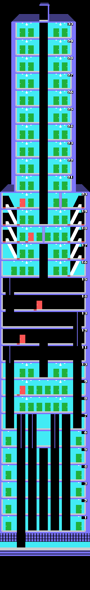
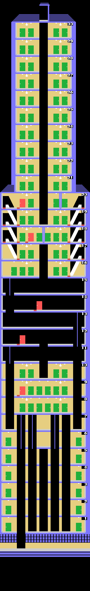
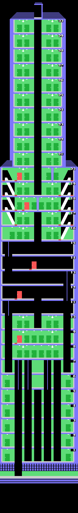
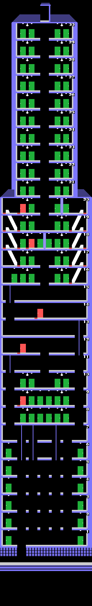

# El edificio

El edificio es siempre el mismo: treinta plantas, la azotea con su antena y el sótano con el coche. Lo que cambia de
una ronda a otra son los colores, qué puertas son rojas y qué ascensor llega al sótano.

Estas imágenes no son capturas. `tools/mapas.py` ejecuta la propia ROM en un Z80 escrito en Python: la carga de
gráficos (`monta_edificio`, 0x4691), el dibujo del mapa en la RAM (`dibuja_edificio`, 0x7E91), los ascensores
(`ascensores_nuevos`, 0x605A) y las puertas (`puertas_nuevas`, 0x6765). Luego pinta el mapa entero con los patrones
que quedan en la VRAM. Se ha cotejado con la RAM de openMSX en el mismo punto de la ronda 1
(`tools/guiones/mapa.tcl`, parado en 0x42A5): **de 7.168 tiles, 7.052 iguales**, y los 116 que cambian son
justo lo que se sortea (puertas rojas, ascensor del sótano, posición de los ascensores) y el cable de la ronda 1.

## Los tres juegos de colores

La ronda 1, 4, 7... usa los colores de 0x8D18; la 2, 5, 8... los de 0x8D38; la 3, 6, 9... los de 0x8D58
(`colores_ronda`, 0x4798). A oscuras, tras romperse una lámpara, se cargan los de 0x8D78.

| rondas 1, 4, 7... | rondas 2, 5, 8... | rondas 3, 6, 9... | a oscuras |
|---|---|---|---|
|  |  |  |  |

## Cómo se dibuja

El mapa vive en la RAM, de 0xC400 a 0xDFFF: 32 tiles de ancho y 224 filas. La pantalla enseña 21 filas y el scroll
es de fila en fila: la interrupción copia esas 21 filas a la VRAM cuando cambian (`vuelca_mapa`, 0x4C76). El
dibujo sale de una lista de piezas por tramos (0x7F8D) que se repiten planta a planta; los números de planta se
escriben aparte, de 30 a 1 (`numero_planta`, 0x7EDD).

Tiles que el código mira para moverse: 0x60 el suelo, 0x2D el hueco de un ascensor, 0x28 su cable, 0x3B el
hueco de dentro de una cabina, 0x61 y 0x64 las paredes, 0x0A y 0x0E el tejado, 0x77 una lámpara y 0x78 la marca
junto a una puerta roja.

## Los once ascensores

Cada ascensor tiene su ficha de 10 bytes en 0xC0EC y su recorrido en la tabla 0x60DB (fila de arriba, de abajo,
columna y fila de salida). Los que están cerca de la vista van y vienen solos y paran 120 cuadros en cada planta;
el que lleva al agente lo mueve el mando.

- **El que baja al sótano se sortea en cada ronda** entre los cinco últimos (`ascensores_nuevos`, 0x605A): su
  recorrido se alarga una planta y se pinta el hueco hasta abajo.
- **Ascensores dobles:** de esos cinco, cada uno tiene 3 posibilidades de 10 de llevar dos cabinas separadas 12
  filas, unidas por el cable.

## Las 58 puertas y las rojas

Las 58 puertas están en la tabla 0x69EB (lado, columna y fila). Las rojas se eligen al azar en cada ronda de tres
grupos de puertas (`puertas_rojas`, 0x67A6, con la tabla 0x682A):

| ronda | 1 | 2 | 3 | 4 | 5 | 6 | 7 | 8 | 9 y siguientes |
|---|---|---|---|---|---|---|---|---|---|
| puertas rojas | 5 | 6 | 7 | 8 | 9 | 10 | 10 | 10 | 10 |

Los enemigos salen por una puerta azul que quede entre cuatro filas por encima y nueve por debajo de la vista
(`puerta_libre`, 0x6732): nunca por una roja.
